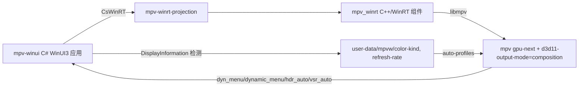

# mpv-winui-player 审查交接（2026-08-07）

> ⚠️ **已过时**：本文为上一轮阶段性记录，内容不可尽信。最终状态以
> `C:\Users\z2637\Documents\Codex\2026-08-07\ikas-mc-mpv-winui-player-winui\outputs\`
> 下的 `mpv-winui-player-audit-20260807.md` 与 `release-prep-checklist-20260807.md`
> 为准（构建、本地化、发布卫生、菜单链路均有最新查证与修改）。

> 新对话先读本文件。上一代项目（mpv-lazy 的 WinUI 菜单宿主）见
> `C:\Users\z2637\Documents\Codex\2026-08-06\c-users-z2637-documents-codex-2026\outputs\mpv-winui-menu-host-handoff-20260807.md`，
> 当前主线已迁移到 mpv-winui-player 自带的 WinUI 菜单，旧菜单宿主不再演进。

## 1. 一句话

当前主线项目 = [ikas-mc/mpv-winui-player](https://github.com/ikas-mc/mpv-winui-player)
（C# WinUI 3 + C++/WinRT `mpv_winrt` 嵌入 libmpv），叠加 `mpv-winui-lazy` 配置层
（mpv-lazy 配置移植）。运行形态为 Debug 非打包（unpackaged），近期目标是让
HDR（含 RTX Video HDR）真实输出、右键菜单完整可用。

## 2. 架构



要点：
- mpv 用 `d3d11-output-mode=composition` 嵌入 WinUI，**mpv 自身拿不到显示器信息**
  （日志：`Failed to query swap chain's output information`），HDR 状态完全由 App
  检测后写入 `user-data/mpvw/color-kind`（SDR/WCG/HDR）与 `user-data/mpvw/refresh-rate`。
- `profiles.conf` 的 `mpvw-sdr/wcg/hdr` 三个 auto-profile 按 color-kind 切换 mpv 输出参数。
- RTX Video HDR：`hdr_auto.lua`（仅 SDR 片源时挂 `@hdr:d3d11vpp=nvidia-true-hdr`）；
  Nvidia VSR：`vsr_auto.lua`（`vf pre @vsr`，保证先超分再转 HDR）；跳转/拖拽时
  `seek_hold.lua` 临时摘除两者。
- 右键菜单：`dyn_menu.lua` 解析 `input.conf` 的 `#menu:` 注释生成 JSON 给 WinUI 菜单，
  `dynamic_menu.lua` 提供“增强脚本”动态子菜单（VSR/RTX HDR/RIFE 等）；菜单重排见
  `mpv-winui-lazy/menu-audit.md`（195 → 160 项）。

## 3. 关键路径

| 角色 | 路径 |
|---|---|
| 播放器源码（fork/参考） | `C:\Users\z2637\Documents\Codex\2026-08-07\mpv-winui-menu-host-handoff-20260807\work\reference\mpv-winui-player` |
| 配置层（当前源） | `...\mpv-winui-player\mpv-winui-lazy\`（mpv.conf / profiles.conf / input.conf / scripts / menu-audit.md / deploy-config.ps1） |
| C# 应用 | `...\mpv-winui\mpv-winui\`（重点 `Modules\Player\MpvPlayerPage_Display.cs`、`MpvPlayerPage_MpvMenu.cs`、`Modules\Player\MpvMediaPlayer.cs`） |
| C++/WinRT 组件 | `...\mpv-winui\mpv-winrt\MpvPlayer.cpp`（Initialize/UpdateDisplayColorInfo，写入 color-kind） |
| 运行配置目录 | `C:\Users\z2637\AppData\Local\mpv-winui\mpv`（mpv.log / hdr_auto.log 在这里） |
| App 日志 | `...\mpv-winui\mpv-winui\bin\x64\Debug\net10.0-windows10.0.26100.0\win-x64\display-info.log` |
| 可执行文件 | `...\mpv-winui\mpv-winui\bin\x64\Debug\net10.0-windows10.0.26100.0\win-x64\mpv-winui.exe` |
| 旧 mpv-lazy 仓库/安装 | `C:\Users\z2637\Documents\Codex\2026-08-04\mpv-lazy-hooke007-mpv-playkit-codex\work\mpv-config`；`C:\Program Files\mpv-lazy` |

## 4. 本会话修复记录（2026-08-07）

### 4.1 HDR“检测到但输出发白/无效”根因与修复

现象链（mpv.log 实锤，19:27 会话）：
1. `mpvw-hdr` 仅设 `d3d11-output-csp=pq`：交换链建为 PQ，但渲染目标仍 SDR
   （`video-target-params.gamma=gamma2.2`），libplacebo 初始配置把交换链重置回 sRGB；
2. 修复一（profiles.conf）：`mpvw-hdr` 补 `target-trc=pq`、`target-prim=bt.2020`、
   `target-peak=1000`（App 实测显示器 maxLuma=1000）→ 8.333s 首帧 hint 切到
   `RGB_FULL_G2084_NONE_P2020`（真 HDR）；
3. 但 8.561s `hdr_auto` 挂上 RTX HDR 滤镜时把 `target-colorspace-hint` 改为 `auto`，
   8.621s hint 立即退回 sRGB——composition 模式下 mpv 拿不到显示器信息，`auto`
   等于禁用 hint，libplacebo 用 sRGB 覆盖交换链，之后整段发白；
4. 修复二（hdr_auto.lua）：挂滤镜期间 `target-colorspace-hint` 固定 `yes`
   （不再写 `auto`），退出恢复原值。

附带修复：`mpvw-wcg` 的 `d3d11-output-csp=display-p3` 是非法取值（mpv 启动即报错），
改为 `bt.2020`；`hdr_auto.log` 改为仅状态变化时写入（原每次同步都追加）。

### 4.2 color-kind 不更新修复（C# 代码，已重新构建部署）

`MpvPlayerPage_Display.cs`：
- 取消注释 `_appWindow.Changed` 订阅：窗口跨显示器移动时触发检查；
- 检查到显示器变化时重建 `DisplayInformation`（否则仍挂旧显示器信息），重读
  color-kind 并 `UpdateDisplayColorInfo` 同步给 mpv；
- 新增 3 秒定时兜底（运行期间 `AdvancedColorInfoChanged` 实际从未触发过）；
- `ReadColorKind(bool log)`：日志只在启动/真实变化时写。

构建产物 `mpv-winui.dll`（954,368 B，19:32）已部署到运行目录。

### 4.3 其他

- 旧 mpv-lazy 安装 `C:\Program Files\mpv-lazy\portable_config\mpv.conf` 的
  `d3d11-output-csp=srgb` → `auto`（窗口模式同类修复，非当前主线）。

## 5. 环境与证据

- 显卡：NVIDIA GeForce RTX 4070 Ti SUPER（驱动 32.0.16.1088），主屏
  3840x2160@165（三星 PnP SAM72C1，Windows 报 HDR、maxLuma=1000、sdrWhite=480）。
- 另有虚拟显示适配器：GameViewer Virtual Display（1920x1080@144）、
  Parsec Virtual Display——审查时注意窗口别落到虚拟屏上，虚拟屏可能干扰 HDR 判断。
- `display-info.log`：每次启动 `kind=HDR advanced=HighDynamicRange maxLuma=1000 sdrWhite=480`，
  说明 App 检测（Windows AdvancedColorInfo）是真实的。
- mpv 版本：v0.41.0-615-g7b057f66f（2026-05-09 构建），libplacebo v7.364.0，
  `--d3d11-output-csp` 有效取值 auto|srgb|linear|pq|bt.2020。

## 6. 构建 / 部署命令

```powershell
# 1) 同步配置层到运行目录
powershell -File mpv-winui-lazy\deploy-config.ps1

# 2) 构建 C# 应用（Debug x64，跳过 MSIX 签名；需先关闭正在运行的播放器）
dotnet build mpv-winui\mpv-winui\mpv-winui.csproj -c Debug -p:Platform=x64 `
  -p:GenerateAppxPackageOnBuild=false -p:AppxPackageSigningEnabled=false

# 3) 运行
mpv-winui\mpv-winui\bin\x64\Debug\net10.0-windows10.0.26100.0\win-x64\mpv-winui.exe
```

注意：C++ 组件 `mpv_winrt` 已有现成产物（`mpv-winui\bin\x64\Debug\mpv_winrt\`），
C# 工程引用其 winmd；未改 C++ 时无需重编。csproj 启用 PublishAot/Trimmed，
但 `dotnet build` 不触发 AOT。

## 7. 已知问题与待办

- 【待实机验证】4.1 修复后重启播放器，确认 mpv.log 中
  `New swap chain configuration received from hint` 持续为 `G2084_P2020` 不再回跳；
  RTX HDR 滤镜生效期间为真 HDR。
- 【待确认】桌面级“开 HDR 发白”与播放器无关：sdrWhite=480 尼特偏高，建议 Windows
  设置里 SDR 内容亮度调至 100~200；另需确认 4K@165 下信号为 10bit
  （DP1.4+/HDMI2.1，否则会掉 8bit 发白）。
- `MpvPlayerPage_Display.cs` 仍有 TODO：窗口实际视图矩形、`display-info.log` 的
  monitor 字段为空、跨屏时仅处理 DidPositionChange。
- `mpv-winui-lazy/` 在 git 中是未跟踪目录（??），需定版本管理策略。
- `mpv.log` 是 `msg-level=all=v`，2.5MB/次会话，正式版应降级。
- 菜单仍有未汉化项、图标（IconMap.cs 新增）待核对；VSR/RTX HDR 入口在
  滤镜与增强 > 增强脚本。
- 旧菜单宿主仓库有 38 个未推送提交与 release 重打包事项（独立项目，见旧交接文档）。
- 多显示器/DPI 实机验证；窗口跨虚拟屏/真实屏时的 color-kind 切换。

## 8. 审查清单主题（用户要求，新项目继续）

1. 插件独立性、MCP 多版本兼容性、对原生 SDK 的调用兼容性；
2. 每个选项的功能可用性、窗口渲染稳定性；
3. 是否有用户可自定义的配置文件；是否默认中英文原生 mpv 配置；
4. 代码逻辑：冗余、缺失、重复、绕圈子、有原生方式却自行编译；
5. 调研 GitHub 热门组件库、相关经验、Windows 官方库；
6. 图标是否自定义、是否有预设图标；
7. 尽量依赖 mpv 本体功能和系统运行库，不新增额外进程/小内存方案；
8. 插件硬编码菜单应为原生 mpv 英文原始菜单，自定义选项经配置文件覆盖。

## 9. 用户偏好 / 约束

- 按 P0 动手、一步步汇报；不要做动态（UI）测试；不改美术效果；大规模重构先汇报。
- 技术方向：优先 mpv 组件与 SDK 实现原生 WinUI 3；不行再最小化依赖。
